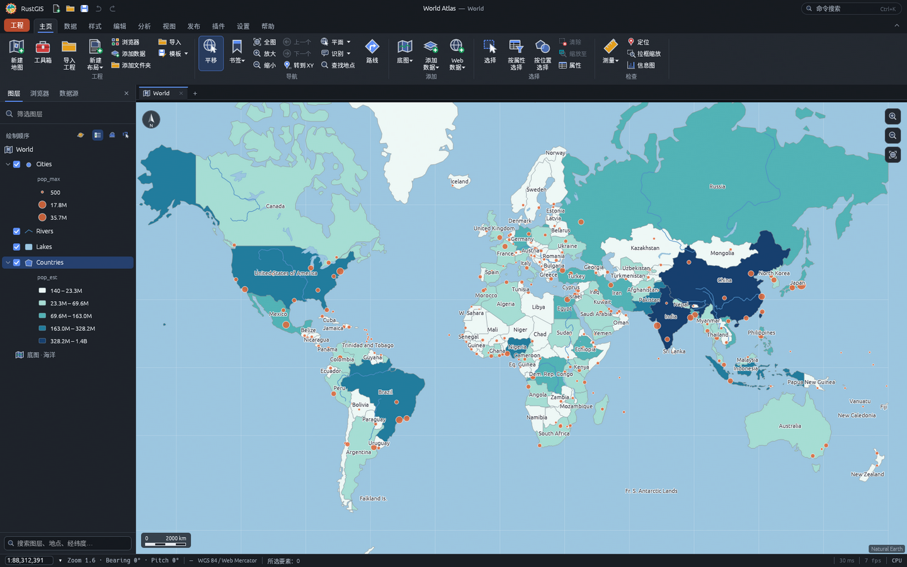
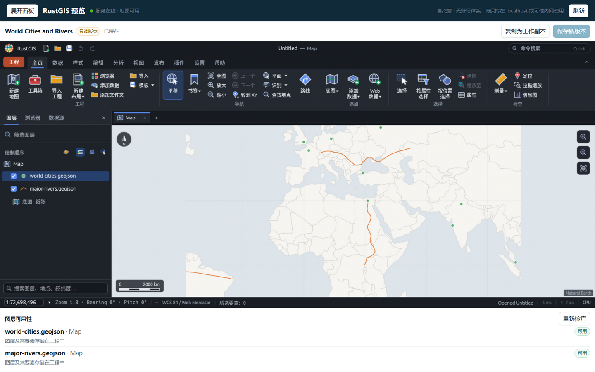
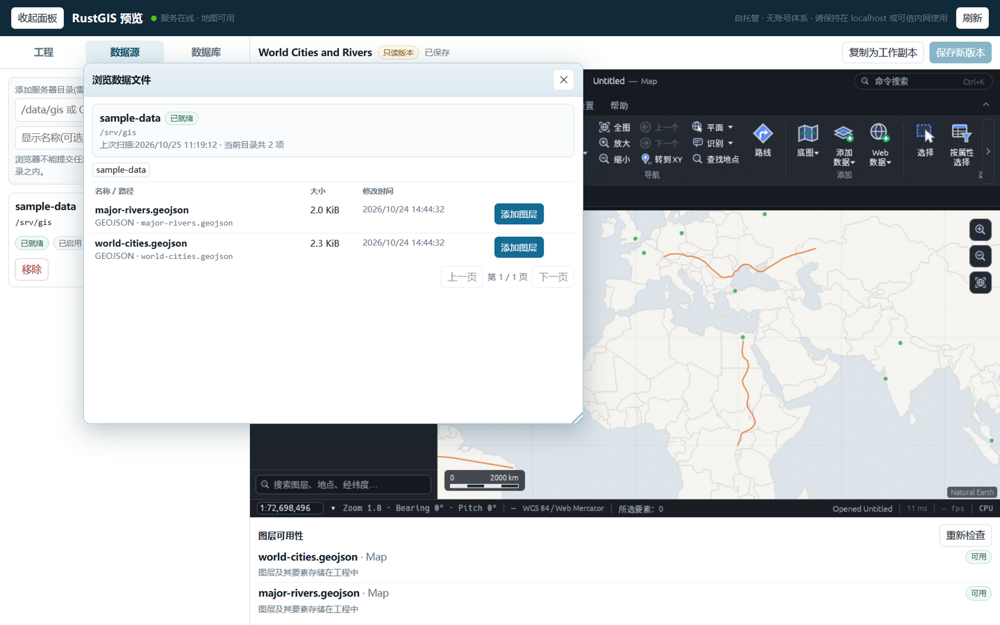
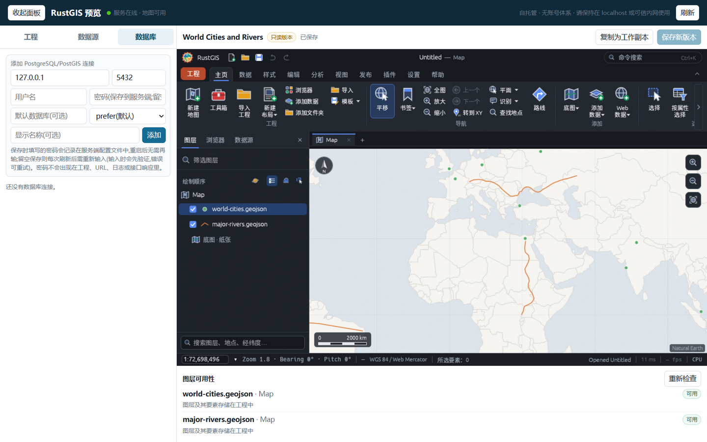

# Preview Server

This repository ships a small, self-hosted preview application built around the RustGIS web map,
renderer, data providers and `.rgis` project format. It is deliberately unaudited for public
internet exposure: there are no accounts, roles or collaborative editing.

The server adds four things the browser app cannot do by itself:

1. persistent source-folder configuration and controlled file reads;
2. persistent PostGIS connection configuration, with an optional save-time password that is
   restored on start (connections saved without one keep asking, memory only);
3. immutable project versions and mutable working copies;
4. an availability check for external layer references when a project opens.

The browser map is the existing `apps/rustgis-web` WebAssembly application, served by the preview
server and also available standalone. The server console is a plain HTML/JavaScript page served at
`/` (the console UI is Chinese, `zh-CN`, in this build); it embeds the map at `/map.html?embed` and
uses the existing `postMessage` embed protocol for `ui.*` commands and complete project JSON. No
second rendering engine, tile server or database proxy is introduced.

## The console

The console at `http://127.0.0.1:8765/` has three tabs — projects (工程), data sources (数据源) and
databases (数据库) — in a sidebar that can be collapsed from the top bar or resized by dragging its
edge (280–450 px). The map on the right is the embedded web app; a draft map can be saved as a
project with one click, and with the sidebar collapsed the map fills the whole window.

Projects are listed as a two-level tree: each project is a group card (name, version and
working-copy counts, description, edit button) that can be collapsed with ▼/▶, and its saved
versions and working copies are rows below it. The file browser and the database browser open in a
floating window — no overlay, draggable, resizable — so the map stays usable while browsing.

Every project keeps an immutable version history. Editing happens in a working copy; saving
publishes a new unique version and never touches the saved ones.

Database connections are configured in the third tab: host, port, user, an optional password that
is saved server-side, SSL mode and a default database. Catalogs and bounded GeoJSON snapshots are
reached through the same server.

## In this section

- [Deploy](deploy.md) — build and run natively or with Docker, configuration variables, path rules per platform
- [Projects](projects.md) — immutable versions, working copies, `.rgis` semantics and layer availability
- [Sources and databases](sources.md) — source roots, controlled file reads, and PostGIS catalogs and snapshots
- [HTTP API](api.md) — the full API surface, limits and security posture
