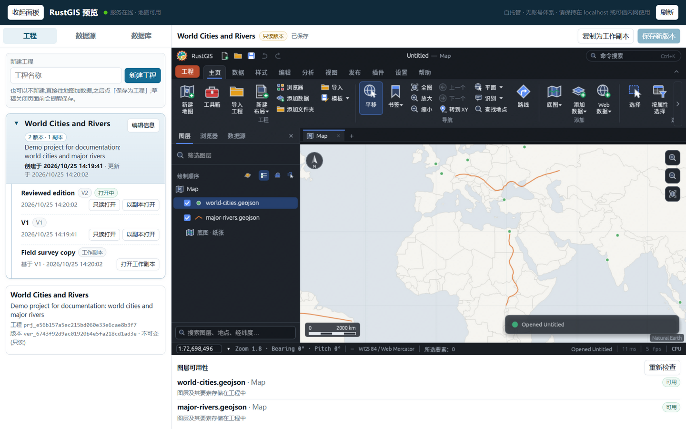

# Projects, Versions and `.rgis`

A project directory contains metadata, immutable versions and working copies:

```text
<home>/projects/<project-id>/
  project.json
  versions/<version-id>.rgis
  working/<working-id>.rgis
```

* Creating a project publishes V1, and the console immediately opens an editable working copy of
  it; layers can also be added to a scratch map first and saved as a project with one click.
* A saved version is read-only through the API. `PUT`, `PATCH`, `DELETE` and `POST` to a version
  route return `409 version_immutable`.
* Editing starts by copying a version to a working copy. Saving the working copy publishes a new
  unique version; the base version is never modified.
* Publication writes a temporary file, syncs it, then uses a no-overwrite operation (`hard_link`
  on Unix, `rename` on Windows) and updates metadata atomically. The temporary name is removed
  after publication, and on restart the index is reconciled with complete files.
* The original `.rgis` semantics are retained. Small vector datasets may be embedded in the
  project; windowed/streamed sources keep a path or URL reference and do not copy all source data.
  A TIFF added through the map's URL import is probed first: a cloud-optimised GeoTIFF (COG) becomes
  a streamed `maps[].tiles` entry with its URL, while a non-COG TIFF is downloaded whole and stored
  as embedded raster bytes in `maps[].layers`. The source browser therefore refuses TIFFs larger
  than 64 MiB; use a known COG from the map's **Add Data From URL** for larger rasters. This is the
  existing RustGIS format, not a new project format.

The projects tab lists every project as a two-level tree: a project group card (name, version and
working-copy counts, description, collapse toggle ▼/▶) with its versions and working copies as
rows. Groups are collapsed by default; the state is remembered for the session, and a group
expands automatically when one of its versions or copies is opened. In this build the console
labels are Chinese: 只读打开 opens a version read-only, 以副本打开 copies it to a working copy,
and 保存新版本 publishes the current working copy as a new version.



## Layer availability

Availability checking covers `maps[].layers` and COG entries in `maps[].tiles` whose URL points
at this server's `/api/files/...` route. A missing COG file is reported as unavailable and the
derived copy hides that tile layer; saving a working copy restores the stored visibility, and
the layer recovers when the file returns. Remote COG URLs stay `unknown` because the server does
not make a network request while opening a project.

Opening a version calls `GET /api/projects/{id}/versions/{version}/prepared`. The server parses the
`.rgis` JSON without `Project::normalize`, checks external file references and returns:

* the original project content with only unavailable layers (including file-API COG tile layers)
  changed to `visible: false`;
* an `availability` report with layer name, map, status, source root if any, and reason. A COG
  entry also carries `tile_index` (its position in `maps[].tiles`) and uses `layer_id: 0`.

The stored `.rgis` is not modified. If the file returns, opening the version again restores the
original visibility because the stored version still carries it. **Recheck** (重新检查) re-reads the stored
version or working copy when there are no unsaved edits; when the map is dirty it posts the current
JSON to `/api/projects/{id}/availability` and re-shows only layers that the previous check hid and
that are now available. The derived copy adds an ignored `x_rustgis_availability` marker; RustGIS
ignores unknown fields and drops the marker the next time it saves the project. If a working copy is
saved while a checked layer or COG tile is unavailable, the console restores its original visibility
in the stored JSON and removes the derived marker; opening the new version still hides it until the
data returns.

The check does not read file contents, open a database, or fetch a URL. Local references must
resolve inside a configured, enabled source root; `..`, absolute paths outside every root, and
symlink/junction escapes are marked unavailable. Remote URLs are reported as `unknown` and are not
hidden, because checking them would make opening a project depend on the network. Live PostGIS,
MySQL, SQL Server, DuckDB and GDAL references without embedded features are marked unavailable in
this browser preview; a PostGIS layer with stored features remains available.
